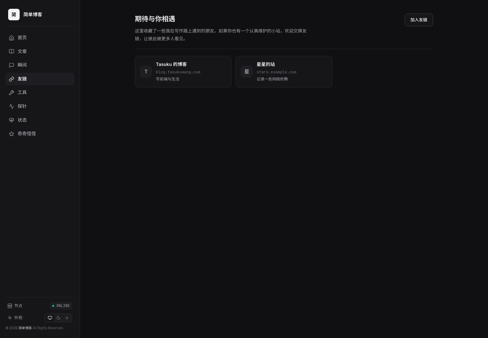
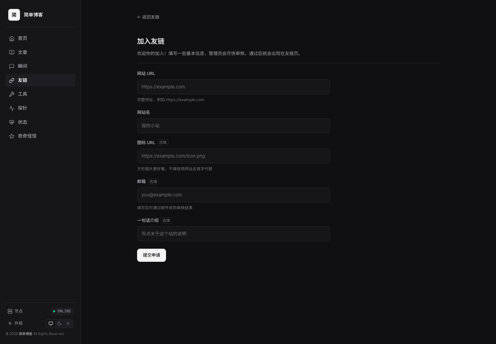
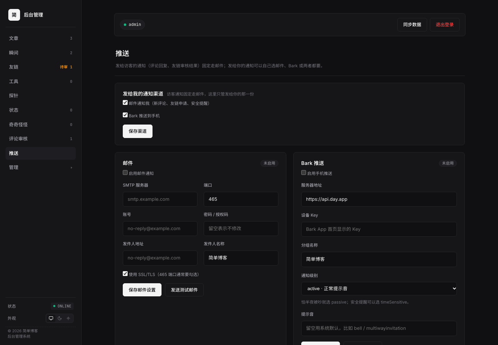
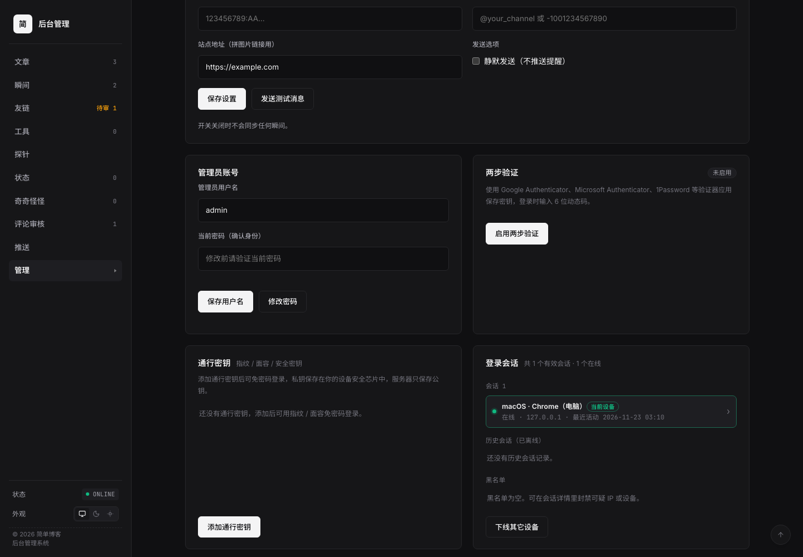
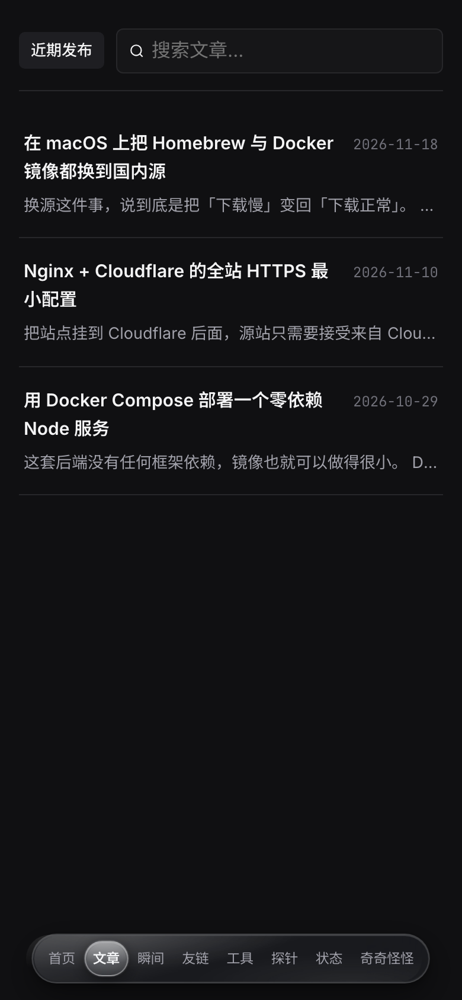
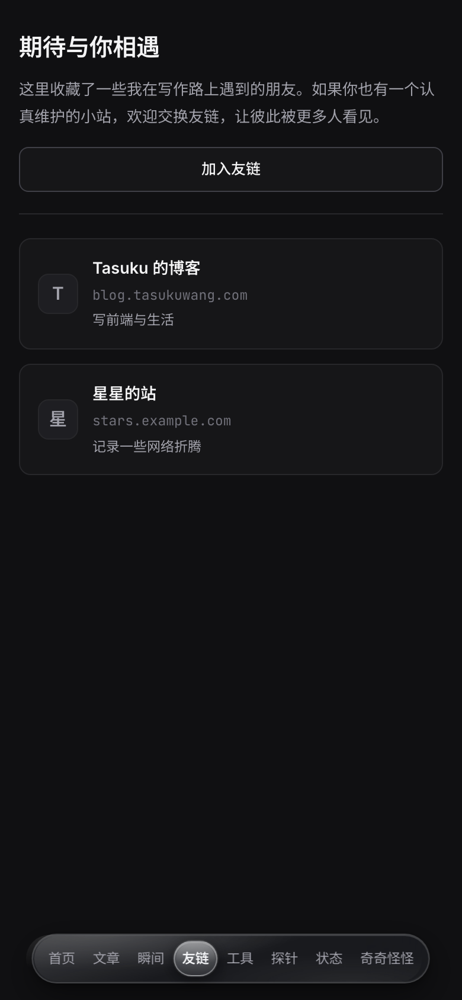

# Simple Blog

[简体中文](README.md) · **English**

A minimal, self-hosted personal blog: **Cloudflare Pages static frontend + self-hosted Node backend**.

The frontend is a build-free static SPA (HTML/CSS/vanilla JS). Pages Functions render each article at the edge so search engines always receive the full text in the HTML. The backend is a zero-framework Node service handling login, content management, image uploads and comments — everything is stored as Markdown / JSON files, so moving to another machine is just copying a directory.

> For people who want to own their data without running a database or a build toolchain. The backend starts with one Docker command; the frontend is hosted for free on Cloudflare.

---

## Screenshots

> Taken from a locally running instance with demo data. The site ships light and dark themes that follow your device / system setting.

### Front end

| Home | Post list |
| --- | --- |
|  |  |
| <sub>Home: avatar, one-line bio and social links; node status and filing badges in the sidebar</sub> | <sub>Post list: newest first, fuzzy search over title / excerpt / tags</sub> |

| Post detail | Comments |
| --- | --- |
|  |  |
| <sub>Post detail: Markdown rendering, language label and line numbers, MIT notice</sub> | <sub>Comments: arithmetic captcha, threaded replies, aligned with the article</sub> |

| Moments | Links |
| --- | --- |
|  |  |
| <sub>Moments: short notes, newest first; can be mirrored to a Telegram channel</sub> | <sub>Links: falls back to the first character when no icon is given</sub> |

| Apply for a link |
| --- |
|  |
| <sub>Apply: URL, name, icon URL and an optional email — nothing is uploaded to your server</sub> |

### Admin

| Login | Posts |
| --- | --- |
|  |  |
| <sub>Login: password + server-side session, optional 2FA and passkeys</sub> | <sub>Posts: Markdown editing and preview, image upload, comment moderation</sub> |

| Links review | Notifications |
| --- | --- |
|  |  |
| <sub>Links review: pending / approved / rejected, reject with a reason, add links manually</sub> | <sub>Notifications: SMTP mail and Bark, with per-channel switches for the site owner</sub> |

| Template editor | Moment sync |
| --- | --- |
|  |  |
| <sub>Template editor: eight templates in three groups, variables allowed</sub> | <sub>Moment sync: posts to a Telegram channel, re-sends on edit, deletes on removal</sub> |

| Settings (site & sections) | Account security |
| --- | --- |
|  |  |
| <sub>Settings: site info, sections, footer filings, social links and admin path</sub> | <sub>Account security: username, 2FA, passkeys, sessions</sub> |

### Mobile

On phones the sidebar collapses into a **liquid-glass bottom bar** that hides on scroll down and returns on scroll up (except on the home page); the current section is marked by a sliding capsule. Spacing is compressed from 375px (iPhone SE) to 430px so all eight entries fit on one row — article text, code blocks, the comment form and the captcha all reflow without horizontal scrolling.

| Mobile home | Mobile post list |
| --- | --- |
|  |  |
| <sub>Glass bottom bar with a sliding capsule</sub> | <sub>Single-column cards with excerpts and tags</sub> |

| Mobile post detail | Mobile links |
| --- | --- |
|  |  |
| <sub>Article body and code blocks reflow to the width</sub> | <sub>One-card-per-row list with the apply button on top</sub> |

## Features

| Area | Description |
| --- | --- |
| Authentication | Username/password with salted `scrypt`, server-side session cookies (HttpOnly / SameSite=Strict), login rate limiting and CSRF protection |
| Settings page | Site info (name / avatar text / browser title / subtitle), username and password change, 2FA, passkeys and session management in one place; changes apply immediately without redeploying |
| Two-factor (2FA) | Standard TOTP (RFC 6238) — scan with Google Authenticator / 1Password, then enter the 6-digit code on login; 10 single-use backup codes |
| Passkeys | WebAuthn fingerprint / face / security-key login; the server stores public keys only, supports multiple devices, also usable as a passwordless login entry |
| Posts | Markdown authoring, live preview, date archives, date ordering |
| Markdown | Headings, nested lists, nested blockquotes, horizontal rules, tables with alignment, task lists, inline styles; fenced code with language label, line numbers, copy button and zoom lightbox; ```` ```mermaid ```` diagrams rendered in the browser |
| Sections | Multiple independently maintained content sections (moments, tools, status, quirky) sharing one CRUD API |
| Image upload | Paste or pick an image in the admin; the server converts it to WebP and caps the long edge at 2560px — the original never touches disk |
| Comments | Visitor comments with captcha, moderation queue, threaded replies, optional contact field (never public) |
| SEO | Real-path routing, per-article SSR, dynamic `sitemap.xml`, `robots.txt`, Open Graph, JSON-LD, IndexNow push (configurable in the admin) |
| Details | A compact “back to top” button appears once a page is longer than the viewport; the admin sidebar submenu opens on hover and can be pinned via the arrow |
| Server probe | The admin sidebar "Probe" page can switch data sources: CF-Server-Monitor (`/api/servers`) or the minimal monitor probe (`/api/nodes`); both are normalized into the same cards |
| Section toggles | Decide per section whether it appears on the frontend ("Settings → Sections"); disabled sections are hidden from the nav and their URLs show a "closed" placeholder page |
| Section customization | Rename (≤ 12 chars), change the URL path (e.g. `/moment` → `/diary`), pick one of 16 built-in icons or upload your own PNG / JPG / SVG / WebP |
| Section ordering | Drag the ⋮⋮ handle in "Settings → Sections"; desktop sidebar, mobile dock and admin sidebar all follow the new order (persisted in `data/site.json`) |
| Custom paths | Sections can use custom paths such as `/diary`; old URLs keep working and redirect, and nav links, `sitemap.xml` and SSR metadata follow the new path |
| Footer & filings | ICP / police / Moe-ICP filing numbers are editable in the admin (empty = hidden). The public site shows icon-only badges: hover to read the number, click to open the official lookup page. The `© year name · All Rights Reserved.` line has its own on/off switch. Everything sits at the bottom of the sidebar and is hidden below 860px; the monochrome icons follow the light/dark theme |
| Friend links | A dedicated `/links` page where visitors submit their site (URL, name, icon URL — no file uploads); submissions wait for review. Without an icon the first character of the site name is used. The admin **Links** page groups them by pending / approved / rejected with approve, reject, edit and delete |
| Notifications | Configure SMTP email and Bark push under **Push**. Notifications **to visitors** (comment replies, link review results) always go out by email; notifications **to the admin** (new comments, link applications, security alerts) can be routed to email, Bark, or both via checkboxes. Eight templates in three groups are editable with a one-click reset; emails use a dark outer frame with a light grey body card |
| Configurable admin path | The dashboard lives at `/admin` by default; change it under **Manage → Site info** to any 2–24 character slug. The old path 302-redirects to the new one |
| Telegram sync | Turn it on in **Manage → Moment sync**; every new or edited moment is posted to your Telegram channel (images included, up to 4) and deleting a moment removes the message. A **Send test message** button verifies the bot/channel pairing |
| Deploy version | Hover the sidebar "Node ONLINE" badge to see the deployed short version, commit and branch |
| Post search | The post-list search box matches title / excerpt / tags; Chinese by substring, English by subsequence; filters as soon as IME composition ends, supports Enter and Esc without rebuilding the input |
| Mobile | Below 860px the layout collapses to one column and a floating dock appears; the dock is a frosted glass panel with specular highlights and a glass selection pill; it auto-hides when scrolling down and returns when scrolling up, fitting all 7 entries even at 320–430px |
| Progressive loading | Site config (section toggles / names / paths / order) is cached in the browser: first paint already matches the last known config, no flash of hidden sections; the home page never waits for the network, node status and probe data refresh on their own; the frontend stays readable when the backend is down |

## Architecture

```
Visitor browser
   │  HTTPS
   ▼
Cloudflare Pages (static frontend)
   │  /post/<id>, /posts etc. are SSR-injected by Pages Functions at the edge
   │  /api/* is not on Pages — it calls the backend cross-origin
   ▼
Your server: Nginx → Docker container (Node 20 + sharp)
   │
   └── data/ article/ img/ file/ … all plain files on the host
```

- **Frontend**: `frontend/`, no build step — Pages publishes the directory as-is.
- **Backend**: `backend/`, Node's native `http` module with a single dependency (`sharp` for WebP).
- **Storage**: no database. Posts live in `article/<id>/<id>.md`, other content and comments are JSON files, images under `img/<date>/`.

## Project structure

```
simple-blog/
├── README.md                 # this file (Chinese: README.md, English: README.en.md)
├── CHANGELOG.md              # changelog
├── LICENSE                   # MIT
├── backend/                  # backend service
│   ├── server.js             # entry: routes, static files, public API
│   ├── admin.html/css/js     # admin UI (login, editor, uploads, moderation)
│   ├── markdown.js           # Markdown renderer shared with SSR
│   ├── backend/
│   │   ├── auth.js           # password, sessions, rate limit, CSRF, 2FA, passkeys
│   │   ├── captcha.js        # comment captcha
│   │   ├── storage.js        # post/JSON IO, filename sanitizing
│   │   ├── image.js          # WebP conversion and resizing
│   │   ├── site.js           # site info, sections, paths, order, probe config
│   │   ├── probe-source.js   # CF / minimal probe adapters
│   │   ├── sitemap.js        # dynamic sitemap
│   │   ├── indexnow.js       # IndexNow push
│   │   └── probe.js          # uptime probes for the status page
│   ├── Dockerfile
│   ├── docker-compose.yml
│   ├── .env.example
│   ├── config.json           # empty seeds for tools/status/quirky
│   └── data/                 # runtime: auth.json, sessions.json, site.json …
├── frontend/                 # static site (Cloudflare Pages)
│   ├── index.html
│   ├── app.js                # routing, rendering, comments, site-config cache
│   ├── style.css
│   ├── markdown.js
│   ├── robots.txt
│   ├── _redirects
│   └── functions/            # Pages Functions: SSR for posts/lists, sitemap proxy, /version
└── docs/
    ├── DEPLOY.md             # detailed deployment and troubleshooting
    ├── API.md                # API reference
    └── screenshots/          # screenshots used by the READMEs
```

## Quick start

Below is the full path from zero to a working site, in order. Each step has a verification command so problems can be located immediately.

### 0. Prerequisites

| Need | Notes |
| --- | --- |
| A server | Linux (Debian/Ubuntu); 1 vCPU / 1 GB RAM is enough; VPS or a home box, as long as it is reachable from the internet |
| A domain | Two subdomains recommended: `www.example.com` for the frontend, `api.example.com` for the backend |
| A Cloudflare account | The frontend is hosted on Pages for free |
| Docker | Docker Engine + Compose plugin installed on the server (checked in step 2.1) |

### 1. Clone (do you need to fork?)

**No fork is required to deploy everything.** Forking only matters if you want automatic deployments from Git, or you plan to modify the code.

| Your situation | What to do |
| --- | --- |
| Just want it running, no code changes | `git clone` this repository (or download the ZIP). Upload the frontend with `wrangler` — no copy under your own account needed |
| Want Cloudflare Pages connected to a repo so pushes auto-deploy | You need a repository **under your own account**: click **Fork**, or clone and push to a new empty repo |
| Plan to maintain and modify the code | Same as above — fork (or create your own repo) and change the URLs |

```bash
# case 1: deploy only, no fork
git clone https://github.com/usxs/simple-blog.git
cd simple-blog

# case 2/3: already forked to your account
git clone https://github.com/<your-name>/simple-blog.git
cd simple-blog
```

> A fork does not track upstream automatically. To sync later, click **Sync fork** on GitHub, or locally `git remote add upstream https://github.com/usxs/simple-blog.git && git fetch upstream && git merge upstream/main`.

### 2. Deploy the backend (on the server)

#### 2.1 Check Docker

```bash
docker --version          # 20.10+
docker compose version    # v2 — the command is `docker compose`, not `docker-compose`
```

If missing (Debian/Ubuntu):

```bash
curl -fsSL https://get.docker.com | sh
```

#### 2.2 Prepare data directories and fix permissions

The container runs as UID `1000`, so the host directories must be writable by that user — otherwise the first setup fails with "data directory is not writable":

```bash
cd backend
mkdir -p data article Musings img file
touch config.json         # must be a file, not a directory (Docker creates a directory for missing mount points)
sudo chown -R 1000:1000 data article Musings img file config.json
```

#### 2.3 Write environment variables

```bash
cp .env.example .env
vim .env
```

At minimum change these four:

```ini
ADMIN_USERNAME=admin
ADMIN_PASSWORD=use-your-own-strong-password   # used once to create the admin on first start
SITE_PUBLIC_URL=https://www.example.com       # frontend URL, used in sitemap and push links
BACKEND_PUBLIC_URL=https://api.example.com    # backend URL, used in robots.txt
```

Leave captcha secret, IndexNow, probe source and site-name seeds empty for now; they are covered later.

#### 2.4 Start it

```bash
docker compose up -d --build
docker compose ps           # should show Up (healthy)
docker compose logs --tail 50
```

> After changing code or `.env`, always rebuild with `--build`; restarting the container does not pick up new code.

#### 2.5 Verify the backend

```bash
curl -s http://127.0.0.1:33001/api/auth/status
# {"ok":true,"authed":false,"setupNeeded":false,"dataWritable":true}
```

`setupNeeded:false` means the admin was created from `.env`; `dataWritable:true` means the directory permissions are correct. If either is `false`, go back to step 2.2.

#### 2.6 Put the backend behind a domain (Nginx + HTTPS)

Reverse-proxy `api.example.com` to `127.0.0.1:33001`. Example (also works as a template in most control panels):

```nginx
server {
    listen 443 ssl http2;
    server_name api.example.com;

    ssl_certificate     /etc/letsencrypt/live/api.example.com/fullchain.pem;
    ssl_certificate_key /etc/letsencrypt/live/api.example.com/privkey.pem;

    client_max_body_size 30m;          # image / attachment uploads

    location / {
        proxy_pass http://127.0.0.1:33001;
        proxy_http_version 1.1;
        proxy_set_header Host              $host;
        proxy_set_header X-Real-IP         $remote_addr;
        proxy_set_header X-Forwarded-For   $proxy_add_x_forwarded_for;
        proxy_set_header X-Forwarded-Proto $scheme;   # required: the backend adds Secure to cookies based on it
        proxy_set_header X-Forwarded-Host  $host;     # WebAuthn rpId depends on it
    }
}
```

Certificates: `certbot --nginx -d api.example.com`.

#### 2.7 Log in to the admin

Open `https://api.example.com/admin.html` and sign in with the credentials from `.env`. Everything — posts, comments, images, section toggles — lives there. Right after the first login, change the password under "Settings → Admin account".

### 3. Deploy the frontend (Cloudflare Pages)

The frontend is plain static files; no build is required. Pick one of two ways:

#### Option A — Connect a Git repository (recommended; pushing publishes automatically)

1. Cloudflare Dashboard → **Workers & Pages** → **Create** → **Pages** → **Connect to Git**, select your repository;
2. Build settings:

| Field | Value |
| --- | --- |
| Framework preset | None |
| Build command | leave empty |
| Build output directory | `frontend` |

3. Save and deploy — you get a `<random>.pages.dev` domain.

#### Option B — Upload from the CLI (no Git needed)

```bash
npm i -g wrangler
wrangler pages deploy frontend --project-name simple-blog
```

> The `functions/` directory must be uploaded together with the rest; `wrangler` compiles it into edge functions. Dragging plain HTML files uploads no Functions, so article pages would lose server-side rendering.

#### 3.1 Configure Pages environment variables

Pages project → **Settings → Environment variables** (add to both Production and Preview):

| Variable | Example | Purpose |
| --- | --- | --- |
| `SITE_URL` | `https://www.example.com` | Site URL used by canonical / OG / sitemap |
| `API_BASE_URL` | `https://api.example.com` | Backend URL used by Functions to fetch posts and the sitemap |
| `SITE_NAME` | `Simple Blog` | Site name (SSR page titles) |
| `SITE_BIO` | `Notes on tech and life.` | Site description (SSR descriptions) |

#### 3.2 Adjust the site's own information

- `frontend/app.js`, top-level `SITE_CONFIG`: site name, author, `apiBaseUrl` (point it at your backend), social links (empty hides them), site start date;
- `frontend/index.html`: `<title>`, `description`, `canonical`, OG tags and the domain in JSON-LD;
- `frontend/robots.txt`: the domain in the `Sitemap:` line.

Commit the changes; Pages redeploys automatically (Option B needs another `wrangler pages deploy`).

#### 3.3 Attach your own domain

Pages project → **Custom domains** → add `www.example.com` and create the CNAME at your DNS provider. Recommendations:

- Redirect the apex `example.com` to `www.example.com` (or the other way round) — don't serve both;
- If both frontend and backend sit behind Cloudflare, make sure no firewall rule blocks the API.

### 4. Post-deploy checklist

Walk through this list — all green means the deployment is fine:

| Check | Expected |
| --- | --- |
| Open `https://www.example.com/` | Home renders, sidebar "Node" shows ONLINE |
| Open any post `/post/<id>` | Full text; in the page source the `<title>` is the post title and `reader-content` contains the body (SSR works) |
| `https://www.example.com/sitemap.xml` | XML with real paths (no `#/`) |
| `https://api.example.com/admin.html` | You can log in |
| Upload an image in the admin | Returned Markdown points to `.webp`, image renders on the frontend |
| Submit a comment | "Pending moderation"; the admin moderation list shows it |
| Disable a section in "Settings → Sections" | It disappears from the frontend nav immediately; visiting its URL shows a "closed" page |

### 5. Submit to search engines

1. Add the site in Google Search Console — **prefer the "Domain" property** (DNS TXT verification) over "URL prefix", otherwise the sitemap host never matches and GSC keeps saying it cannot be read;
2. Bing Webmaster Tools can import the site from GSC directly;
3. Submit `https://www.example.com/sitemap.xml` in both;
4. For faster Bing indexing of new posts: open **Admin → Search engine push**, generate a key with `openssl rand -hex 16`, paste it and save. Use **Download key file** to get `<KEY>.txt`, deploy it at the `frontend/` root together with the site, then click **Check key file** to confirm. (`INDEXNOW_KEY` in the environment still works; the admin value wins.)

Detailed steps, certificates, backups and troubleshooting: [docs/DEPLOY.md](docs/DEPLOY.md).

## Environment variables

Backend (`backend/.env`):

| Variable | Required | Description |
| --- | --- | --- |
| `ADMIN_USERNAME` / `ADMIN_PASSWORD` | one way or the other | Creates the admin on first start; otherwise set it up on the admin "setup" page |
| `SITE_PUBLIC_URL` | yes | Frontend URL used in the sitemap and push links |
| `BACKEND_PUBLIC_URL` | yes | Backend URL written into the `robots.txt` Sitemap line |
| `CAPTCHA_SECRET` | no | Generated automatically and persisted to `data/captcha-secret.json` when empty |
| `INDEXNOW_KEY` | no | Can also be set in the admin (takes precedence); when present, publish/delete pushes URLs to Bing and friends |
| `INDEXNOW_KEY_LOCATION` | no | Full URL of the key file; defaults to `${SITE_PUBLIC_URL}/<KEY>.txt` |
| `PROBE_ENABLED` | no | Enables frontend probe data; `0` disables (default enabled) |
| `PROBE_PROVIDER` | no | Probe type: `cf` (CF-Server-Monitor) or `minimal` (minimal monitor) |
| `PROBE_URL` | no | Probe panel base URL; the backend appends `/api/servers` (cf) or `/api/nodes` (minimal) |
| `PROBE_PANEL_URL` | no | Target of the "open monitor" button; hidden when empty |
| `SITE_NAME` / `SITE_AVATAR` / `SITE_TITLE` / `SITE_SUBTITLE` | no | Initial site info; editable in "Settings" afterwards, applies immediately |
| `WEBAUTHN_RP_ID` / `WEBAUTHN_ORIGIN` | no | Passkey RP ID and origin; derived from `X-Forwarded-Host` by default |
| `HOST_PORT` | no | Host port, default `33001` |
| `ADMIN_PATH` | no | Initial dashboard path, default `admin`; can be changed later in the dashboard |
| `AUTH_DATA_DIR` | no | Overrides the directory holding sessions, credentials, links and notification config (mainly for tests) |

## API reference

Public (no login):

```
GET  /api/sync?module=posts            # post list (anonymous: summaries + ETag; logged in: full text)
GET  /api/search?q=<query>[&limit=20]  # search (Chinese substring / English subsequence, returns snippets)
GET  /api/comments?postId=<id>         # approved comments
GET  /api/public/post/<id>             # single post (used by Pages Functions SSR)
GET  /api/site                         # site info (name/avatar/title/subtitle/sections/paths/order)
GET  /version                          # (Pages) current deployment short version
GET  /api/deploy-version               # backend proxy of /version (60s cache) for the admin badge
GET  /api/probe-servers                # probe nodes (source chosen in the admin "Probe" page)
GET  /api/captcha                      # captcha question and signature
POST /api/comments/submit              # submit a comment (captcha + honeypot)
GET  /sitemap.xml  GET /robots.txt     # SEO
```

Authenticated (cookie session):

```
GET  /api/auth/status                  # login state / whether setup is needed
POST /api/auth/setup | login | logout | change-password
POST /api/auth/passkey/login-options | passkey/login   # passwordless login (public)
GET  /api/sync?module=comments         # includes pending comments
POST /api/save    POST /api/delete     # create/update/delete content
POST /api/upload                       # image/attachment upload (images become WebP)
GET  /api/admin/overview               # settings summary (site/2FA/passkeys/sessions)
POST /api/admin/site                   # save site info
POST /api/auth/change-username         # change admin username
POST /api/auth/totp/setup | enable | disable | backup-codes
GET  /api/auth/passkeys                # passkey list
POST /api/auth/passkey/register-options | register | delete
GET  /api/auth/sessions                # active sessions
POST /api/auth/sessions/revoke-others  # sign out other devices
```

Full parameters: [docs/API.md](docs/API.md).

## Security notes

- Passwords are hashed with salted `scrypt` (N=16384, r=8, p=1) and compared in constant time; usernames are handled the same way to avoid enumeration.
- Session tokens live only in a cookie; the server stores just their SHA-256. The cookie is `HttpOnly` + `SameSite=Strict` and gets `Secure` under HTTPS. Sliding 7 days, absolute cap 30 days.
- Login is rate-limited per IP: 5 failures in 15 minutes lock the IP for 15 minutes; failures always say "invalid username or password".
- Every write checks `Origin` / `Sec-Fetch-Site`; cross-site writes are rejected with 403.
- Uploaded filenames are sanitized (path separators and control characters removed); images are converted server-side and the original is never written.
- 2FA is standard TOTP (HMAC-SHA1, 30-second step, ±1 window); backup codes are stored as SHA-256 and invalidated on use.
- Passkeys use WebAuthn: the server keeps only public keys and signature counters; challenge, origin, rpIdHash and counter rollback are verified.
- Changing the password, disabling 2FA, deleting a passkey and renaming the admin all require the current password.

> Always serve over HTTPS. On plain HTTP the `Secure` cookie flag is dropped and passwords travel in clear text.

## Notes

> **Bump the asset version when you change CSS/JS**: `frontend/index.html` references
> `style.css`, `markdown.js` and `app.js` with a `?v=` query string. Cloudflare caches
> static assets at the edge for up to 4 hours, so after editing those files change
> `?v=20261122-1` to a new value, otherwise browsers may keep using the old copy.


1. **Rebuild after code changes**: `docker compose up -d --build`. Data lives on the host, so rebuilding loses nothing.
2. **Directory permissions**: the container runs as UID 1000, so `data/`, `article/`, `img/` … must be writable by `1000:1000`, otherwise the first setup fails with "data directory not writable".
3. **`config.json` is a file mount**: if the host file is missing, Docker mounts a **directory** with that name and the backend cannot read its config. Make sure `backend/config.json` exists before the first start (the repo ships an empty template).
4. **Image formats**: `.jpg/.jpeg/.png/.gif` become WebP; SVG and AVIF stay as-is; existing `.webp` is never re-encoded. If the converted file would be larger, the original is kept. Set `IMAGE_WEBP_DISABLE=1` to disable conversion.
5. **Old images are not converted**: old posts reference the filenames of their time, and re-converting would break links, so only later uploads are converted.
6. **Site name / domain appear in several places**: name, avatar text, browser title and subtitle can be changed in "Settings" (the frontend reads `/api/site`; SSR reads it too) without redeploying. Static meta in `index.html`, `functions/` env vars and the domain in `robots.txt` still need manual updates (for search engines and no-JS clients).
7. **Section toggle / rename / path / icon / order** all live in "Settings → Sections" and apply immediately without redeploying. Disabled sections disappear from the frontend sidebar, the mobile dock and the admin sidebar (re-enable them in the same page). The home section can be renamed and re-iconed but not disabled.
   - Paths accept letters, digits and hyphens only (1–24 chars) and may not collide with reserved paths such as `post`, `api`, `admin`; two sections cannot share a path
   - After a path change the old URL still works (302 to the new one), but `sitemap`, nav links and SSR metadata follow the new path
   - Uploaded icons live in `img/<date>/` — include them in backups
   - Drag the ⋮⋮ handle to reorder; the frontend sidebar, mobile dock and admin sidebar all follow
   - Footer: filing numbers only render as icon badges (hover = number, click = official query page); `© year name · All Rights Reserved.` is toggled by "Show copyright line" and never displayed in the admin preview
8. **Site config is cached in the browser**: the frontend stores the last `/api/site` (section toggles / names / paths / order) in `localStorage` under `sp_site_cache_v1`, so the first paint already matches it — hidden sections never flash — and the site still renders when the backend is unreachable or slow. New values are fetched on the next visit and replace the cache (the backend uses `updatedAt` to detect changes). If a change doesn't show up, hard-refresh (`Cmd/Ctrl + Shift + R`) or clear that key.
9. **First paint never waits for the backend**: home, lists and posts render from cached data / SSR content first; node status, probe data and backend config refresh asynchronously. A slow or dead backend never blanks the page — the node badge just shows OFFLINE.
10. **SEO and domains**: `canonical` uses `SITE_URL`. If both `example.com` and `www.example.com` answer, pick one and 301 the other, otherwise you get duplicate content.
11. **Backups**: back up `config.json`, `article/`, `Musings/`, `img/`, `file/` and `data/` under `backend/` — six paths; `tar` them and keep a copy elsewhere.
12. **2FA backup codes**: the 10 codes shown when enabling 2FA are displayed once — save them. Lost authenticator and no codes? Delete the `totp` field in `backend/data/auth.json` on the server and restart (2FA turns off).
13. **Passkeys require HTTPS**: browsers do not expose the Passkey API over `http://` or a bare IP. The backend derives `rpId` from `X-Forwarded-Host`; if the proxy domain and backend domain differ, set `WEBAUTHN_RP_ID` / `WEBAUTHN_ORIGIN` explicitly. Keys are bound to the domain — changing domains means registering again.
14. **Diagrams depend on a CDN**: ```` ```mermaid ```` blocks are rendered in the browser by lazily importing `mermaid@11` from jsDelivr — not bundled. Offline/intranet setups don't break; the block stays as source text. To change the CDN, edit the `import()` URL in `loadMermaid()` in `frontend/app.js` and `backend/admin.js`.
15. **Comment anti-spam**: two comments from the same IP must be at least 30 seconds apart, at most 8 per hour and 30 per day; the captcha issues at most 30 challenges per 10 minutes. Limits return `429` with `Retry-After`, and the submit button shows a countdown. To relax for real visitors, change `CAPTCHA_MAX` in `backend/captcha.js` and the interval/count constants in `backend/server.js`.
17. **Syncing moments to Telegram**: enable it in **Manage → Moment sync** and fill in two fields — the `Bot Token` from [@BotFather](https://t.me/BotFather) (`123456789:AA…`) and the channel id (`@your_channel` or a `-100…` number). The bot must be in the channel with permission to post, otherwise the API answers *not enough rights*. Images inside a moment are uploaded too; their URLs are built from **Site URL**, so it must be reachable from the internet. Editing deletes the old message and posts a new one; deleting removes it from the channel. Config lives in `backend/data/telegram.json` (0600), message ids in `telegram-map.json`.

16. **Post ordering**: both the admin list and the frontend order by publish date (`date`) descending, then modification time. To reorder, edit the `date` inside the post.

## Troubleshooting

| Symptom | Cause and fix |
| --- | --- |
| Admin returns 502 | The container is not running: `docker compose ps` / `docker compose logs --tail 100` |
| Setup says "data directory not writable" | Wrong ownership: `sudo chown -R 1000:1000 data article Musings img file` |
| `Conflict. The container name "..." is already in use` | A container with that name exists from another compose project: `docker rm -f simple-blog-backend` then `up -d` again |
| Frontend loads but posts 404 / empty list | Wrong `API_BASE_URL`, or CORS blocked; check `/api/sync` in the browser console |
| Uploaded images stay jpg | `sharp` failed to build (look for a warn in `docker compose logs`) — rebuild; or `IMAGE_WEBP_DISABLE=1` is set |
| sitemap shows the home page | Pages Functions not deployed (the directory must be named `functions/`), or `_redirects` points to the wrong domain |
| Section changes don't show up | The frontend uses the cached site config: hard-refresh (`Cmd/Ctrl + Shift + R`) or run `localStorage.removeItem('sp_site_cache_v1')` and reload |
| Blank line above the first sidebar item | Layout bug in older builds (empty `<li>` left behind after reordering); update `frontend/app.js` and `frontend/style.css` |

## Changelog

See [CHANGELOG.md](CHANGELOG.md).

## License

[MIT](LICENSE)
